# Tiny Cursor Packs

89 套 Windows 角色光标。每套保留原图的 16 个动作，完成透明背景处理、系统状态匹配和热点校准。

[下载完整合集](https://github.com/jinhongsop-ux/tiny-cursor-packs/releases/latest) · [浏览单套光标](#角色目录)

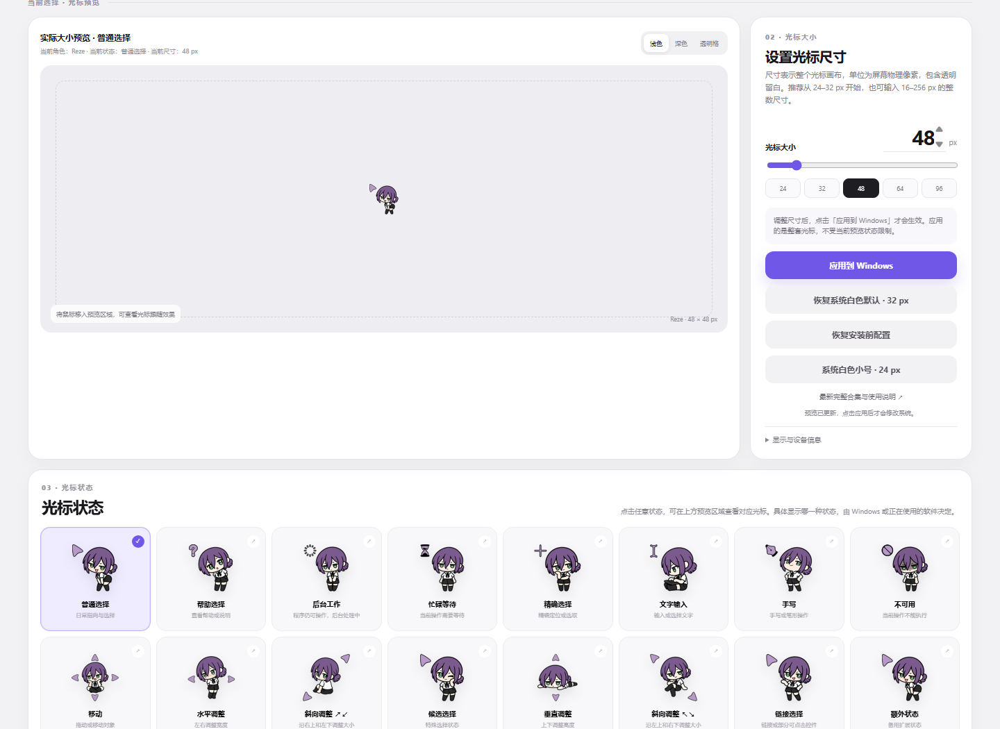

## 使用方法

**完整合集**：完整解压后，双击根目录的 **总工作台.exe**，浏览器会自动打开本地HTML工作台。

**单个角色**：下载并解压下方的单套包，双击 **工作台.exe**。也可以从合集的 `角色光标/` 中复制整个角色文件夹独立使用。

在工作台选择角色、光标状态、背景和尺寸，再点击 **应用到 Windows**。默认24 px，支持输入16–256的整数像素。

提供 **恢复安装前配置**、**系统白色小号**（24 px）和 **恢复系统默认**（32 px）。首次备份会保留，切换角色不会覆盖。

需要Windows 10/11、系统自带的.NET Framework、Windows PowerShell和浏览器。无需Skill、Python或Node，无需联网。托盘菜单可重新打开网页或退出，退出保留当前光标。

普通HTML文件不能直接修改Windows。请通过工作台.exe打开；保留包内web文件夹、catalog.json和角色资源。

## 包内文件

- `工作台.exe`：启动本地HTML界面，连接Windows应用与恢复功能。
- `web/`：HTML、CSS和JavaScript界面。
- `cursors/`：多尺寸CUR和预览PNG。
- `images/`：透明原尺寸PNG。
- 状态预览、manifest.json、catalog.json、中文说明与独立系统恢复脚本。

预览与应用共用相同的透明图片和缩放结果。应用前会将Windows原生绘制与PNG在黑、白背景上的结果逐像素核查，避免渲染链路改变颜色。不会整体调亮或增饱和改变原色。

每套16个动作覆盖17个Windows状态，位置选择和人员选择复用额外状态。尺寸包含透明边距；位图放大不会增加细节。重新登录或修改显示设置后，若尺寸改变，请重新应用。部分软件自行绘制指针。

仓库只收录成品和使用说明，不含Skill或生成工具。流萤（048）和库洛米（060）源PNG损坏，等待完整素材后补入。

## 角色目录

编号保留素材顺序；同名角色的不同版本分别保留。

| 状态预览 | 角色 | 下载与预览 |
| --- | --- | --- |
| 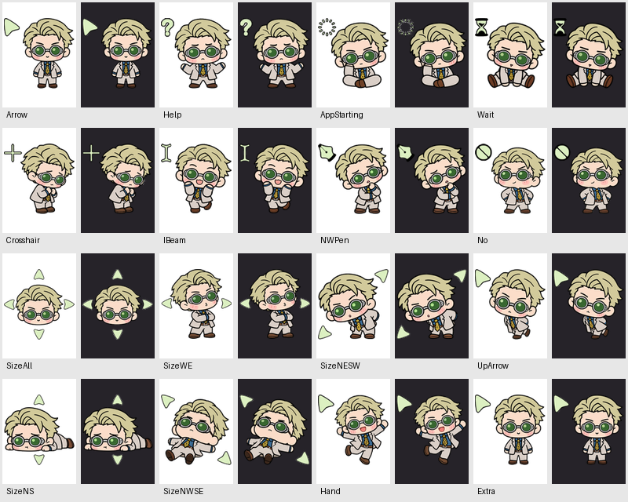 | Kento Nanami | [下载](https://github.com/jinhongsop-ux/tiny-cursor-packs/raw/refs/heads/main/packs/002-kento-nanami.zip) · [大图](previews/002-kento-nanami.png) |
| 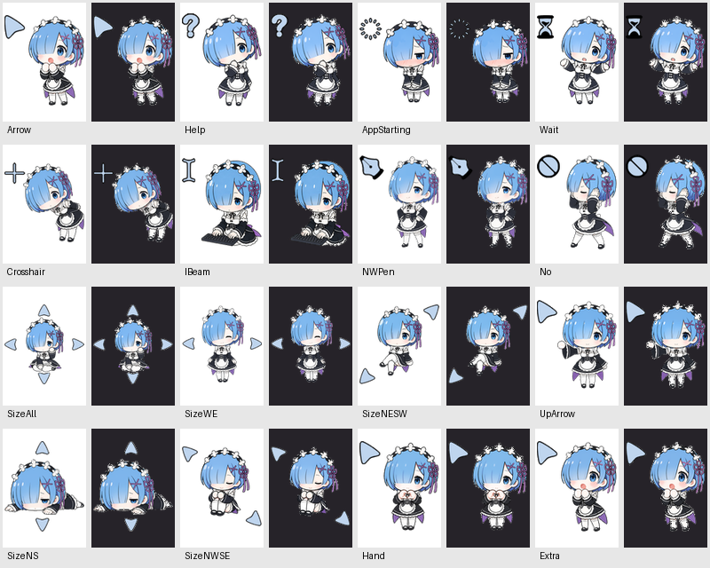 | Rem | [下载](https://github.com/jinhongsop-ux/tiny-cursor-packs/raw/refs/heads/main/packs/003-rem.zip) · [大图](previews/003-rem.png) |
| 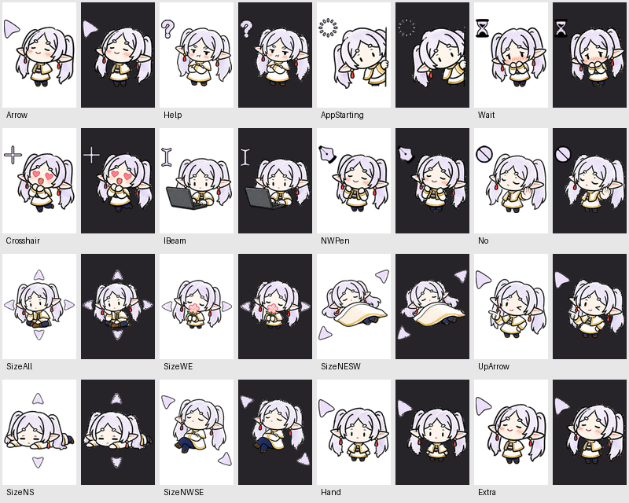 | Frieren (Series1) | [下载](https://github.com/jinhongsop-ux/tiny-cursor-packs/raw/refs/heads/main/packs/004-frieren-series1.zip) · [大图](previews/004-frieren-series1.png) |
| 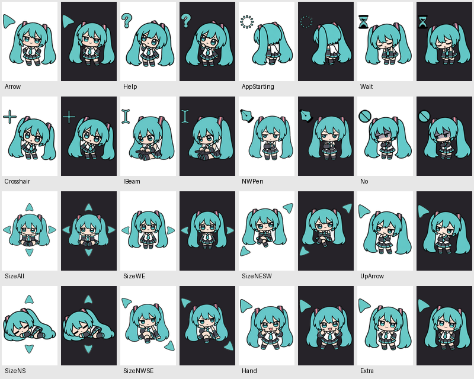 | Miku (Series2) | [下载](https://github.com/jinhongsop-ux/tiny-cursor-packs/raw/refs/heads/main/packs/005-miku-series2.zip) · [大图](previews/005-miku-series2.png) |
| 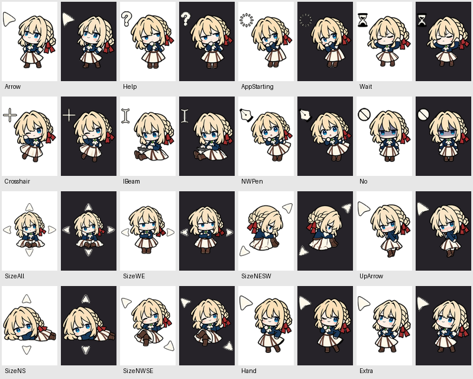 | Violet Evergarden | [下载](https://github.com/jinhongsop-ux/tiny-cursor-packs/raw/refs/heads/main/packs/006-violet-evergarden.zip) · [大图](previews/006-violet-evergarden.png) |
| 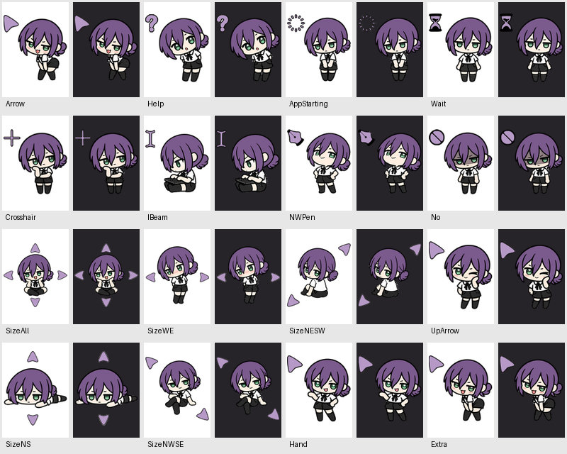 | Reze | [下载](https://github.com/jinhongsop-ux/tiny-cursor-packs/raw/refs/heads/main/packs/007-reze.zip) · [大图](previews/007-reze.png) |
| 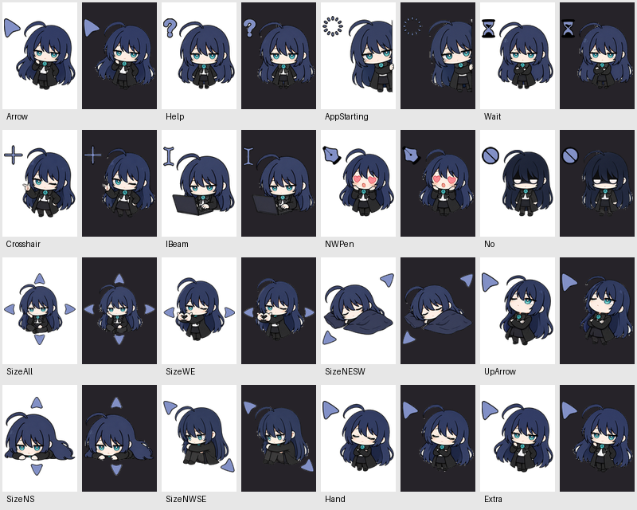 | Ado | [下载](https://github.com/jinhongsop-ux/tiny-cursor-packs/raw/refs/heads/main/packs/008-ado.zip) · [大图](previews/008-ado.png) |
| 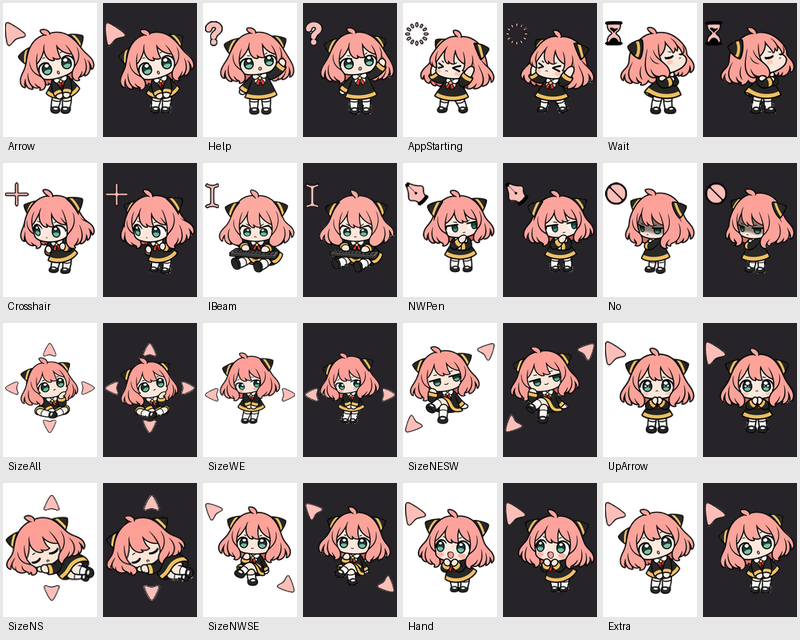 | Anya Forger | [下载](https://github.com/jinhongsop-ux/tiny-cursor-packs/raw/refs/heads/main/packs/009-anya-forger.zip) · [大图](previews/009-anya-forger.png) |
| 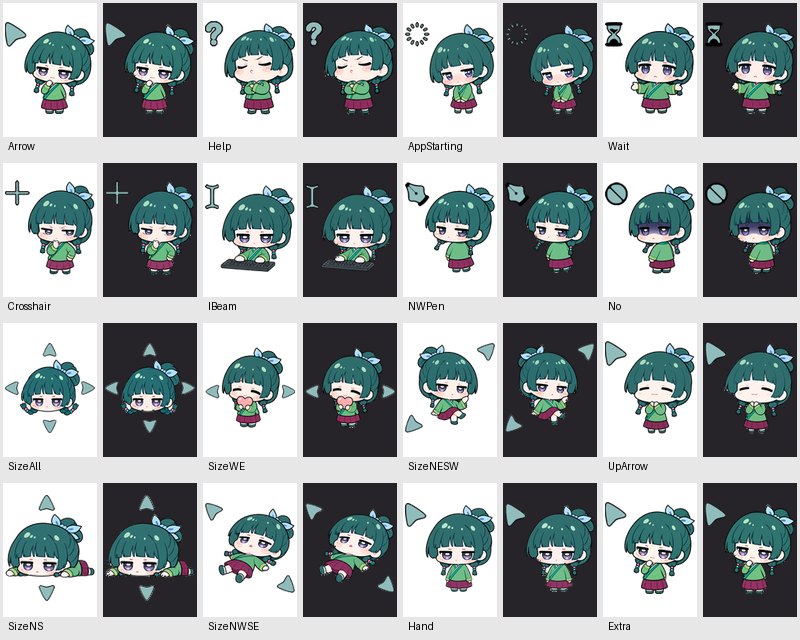 | Maomao | [下载](https://github.com/jinhongsop-ux/tiny-cursor-packs/raw/refs/heads/main/packs/010-maomao.zip) · [大图](previews/010-maomao.png) |
| 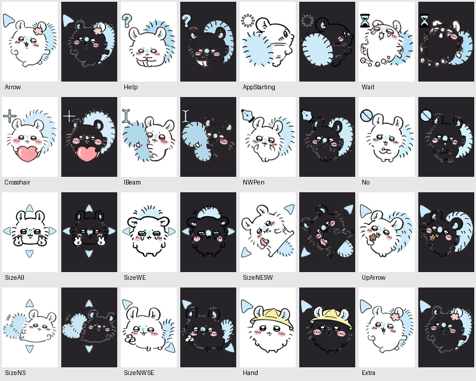 | Momonga | [下载](https://github.com/jinhongsop-ux/tiny-cursor-packs/raw/refs/heads/main/packs/011-momonga.zip) · [大图](previews/011-momonga.png) |
| 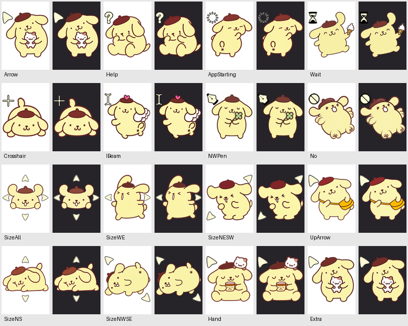 | Pompompurin | [下载](https://github.com/jinhongsop-ux/tiny-cursor-packs/raw/refs/heads/main/packs/012-pompompurin.zip) · [大图](previews/012-pompompurin.png) |
| 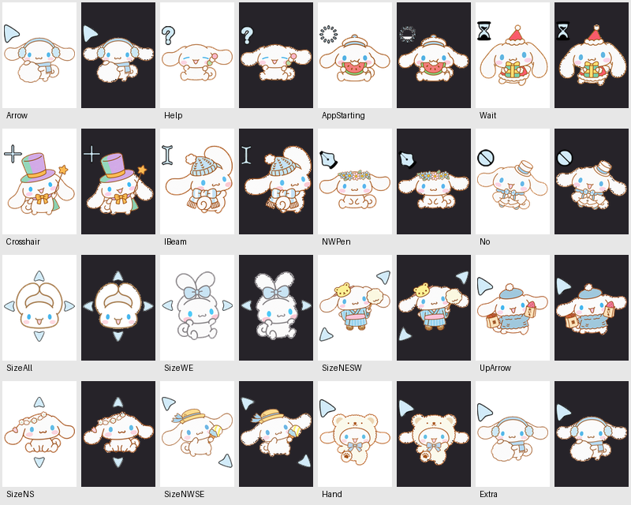 | Cinnamoroll | [下载](https://github.com/jinhongsop-ux/tiny-cursor-packs/raw/refs/heads/main/packs/013-cinnamoroll.zip) · [大图](previews/013-cinnamoroll.png) |
| 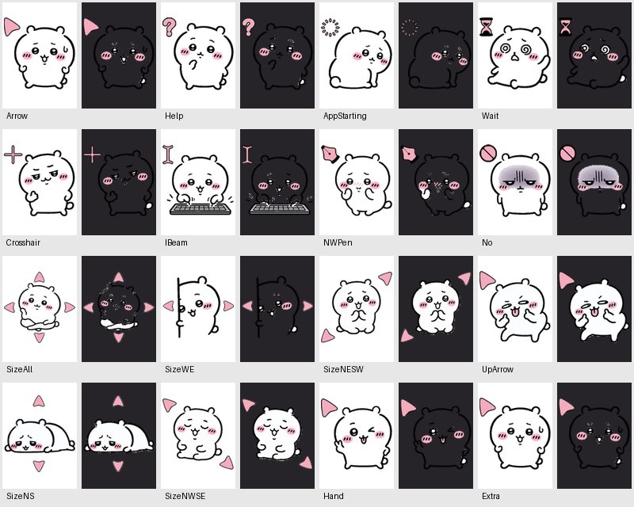 | Chiikawa | [下载](https://github.com/jinhongsop-ux/tiny-cursor-packs/raw/refs/heads/main/packs/014-chiikawa.zip) · [大图](previews/014-chiikawa.png) |
| 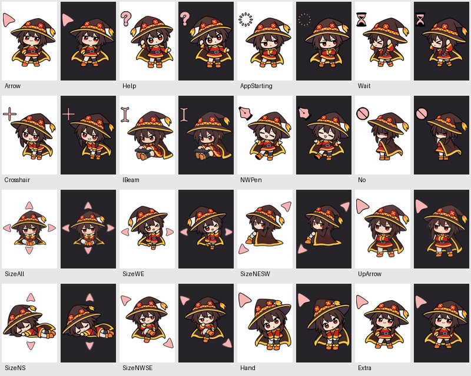 | Megumin | [下载](https://github.com/jinhongsop-ux/tiny-cursor-packs/raw/refs/heads/main/packs/015-megumin.zip) · [大图](previews/015-megumin.png) |
| 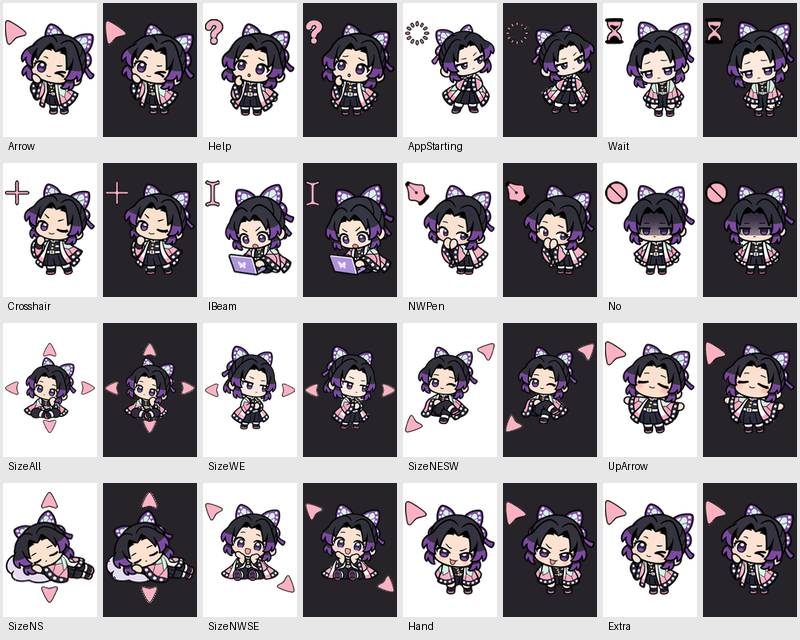 | Shinobu Kocho | [下载](https://github.com/jinhongsop-ux/tiny-cursor-packs/raw/refs/heads/main/packs/016-shinobu-kocho.zip) · [大图](previews/016-shinobu-kocho.png) |
| 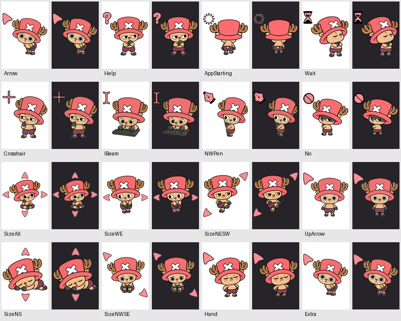 | Chopper | [下载](https://github.com/jinhongsop-ux/tiny-cursor-packs/raw/refs/heads/main/packs/017-chopper.zip) · [大图](previews/017-chopper.png) |
| 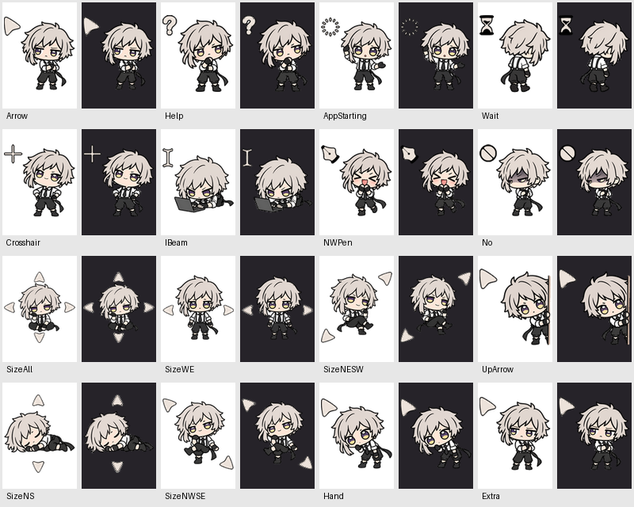 | Nakajima Atsushi | [下载](https://github.com/jinhongsop-ux/tiny-cursor-packs/raw/refs/heads/main/packs/018-nakajima-atsushi.zip) · [大图](previews/018-nakajima-atsushi.png) |
| 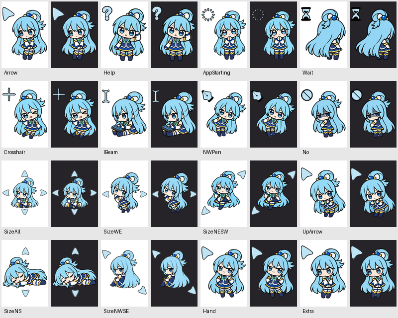 | Aqua | [下载](https://github.com/jinhongsop-ux/tiny-cursor-packs/raw/refs/heads/main/packs/019-aqua.zip) · [大图](previews/019-aqua.png) |
| 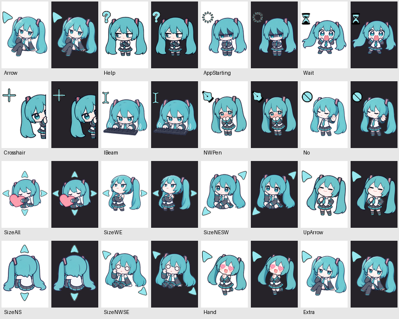 | Miku (Series1) | [下载](https://github.com/jinhongsop-ux/tiny-cursor-packs/raw/refs/heads/main/packs/020-miku-series1.zip) · [大图](previews/020-miku-series1.png) |
| 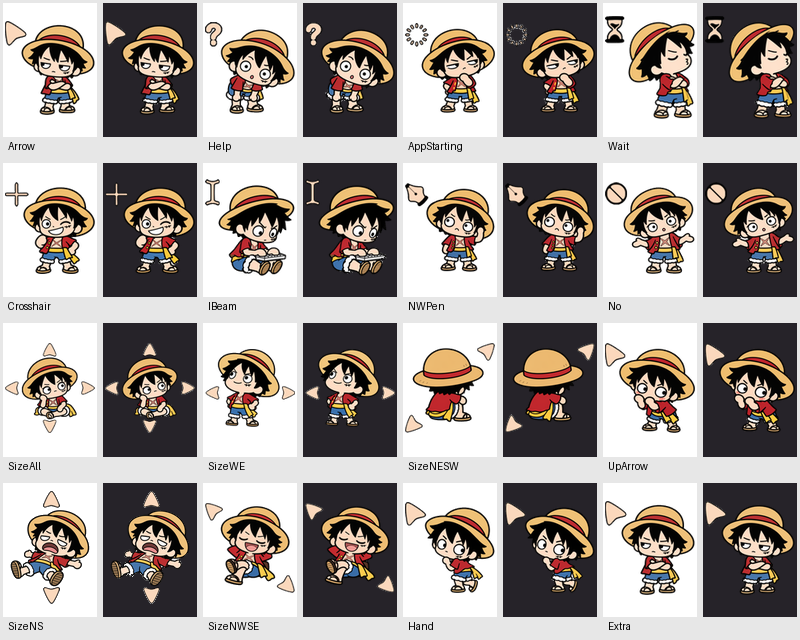 | Luffy | [下载](https://github.com/jinhongsop-ux/tiny-cursor-packs/raw/refs/heads/main/packs/021-luffy.zip) · [大图](previews/021-luffy.png) |
| 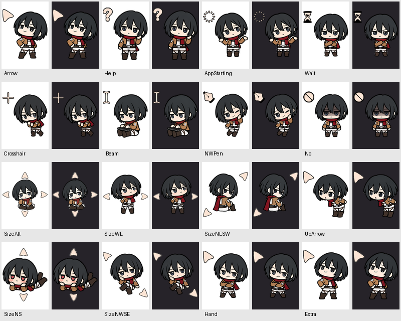 | Mikasa Ackerman | [下载](https://github.com/jinhongsop-ux/tiny-cursor-packs/raw/refs/heads/main/packs/022-mikasa-ackerman.zip) · [大图](previews/022-mikasa-ackerman.png) |
| 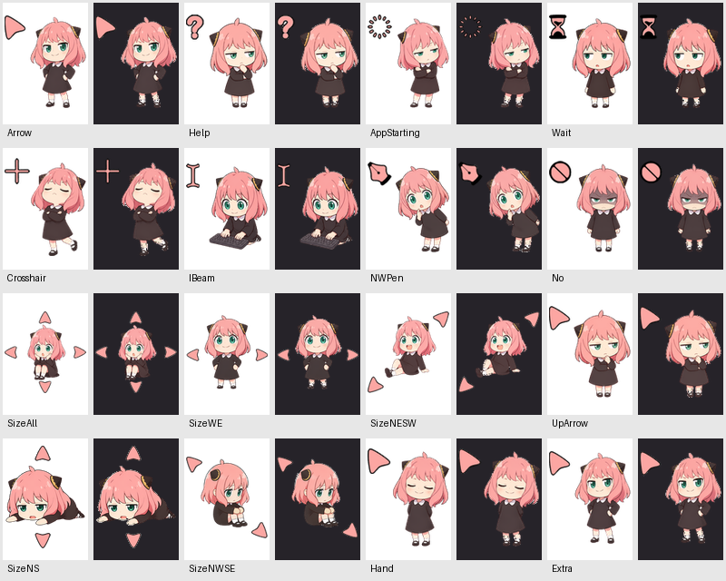 | Anya | [下载](https://github.com/jinhongsop-ux/tiny-cursor-packs/raw/refs/heads/main/packs/023-anya.zip) · [大图](previews/023-anya.png) |
| 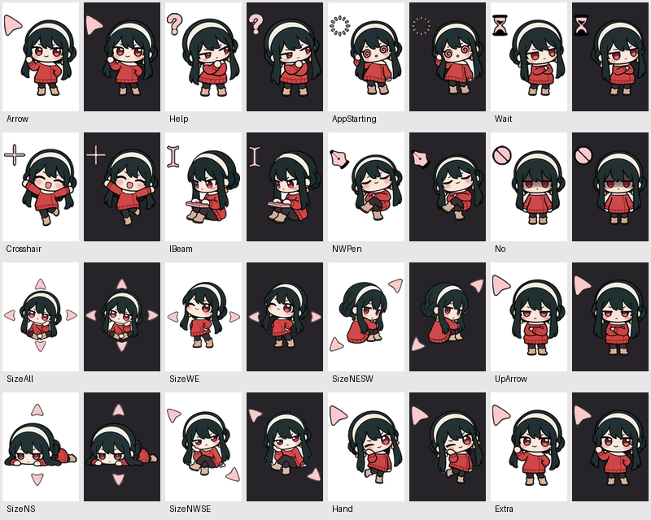 | Yor Forger | [下载](https://github.com/jinhongsop-ux/tiny-cursor-packs/raw/refs/heads/main/packs/024-yor-forger.zip) · [大图](previews/024-yor-forger.png) |
| 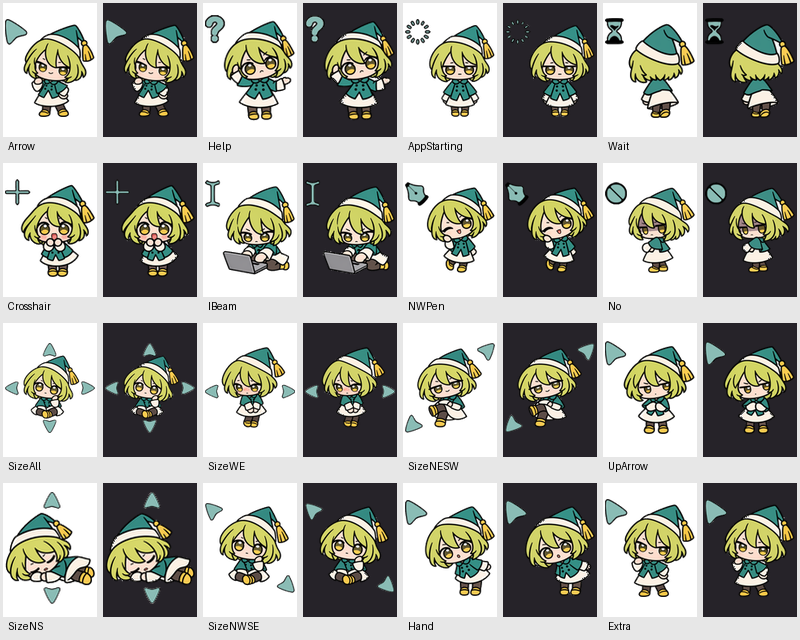 | Coco | [下载](https://github.com/jinhongsop-ux/tiny-cursor-packs/raw/refs/heads/main/packs/025-coco.zip) · [大图](previews/025-coco.png) |
| 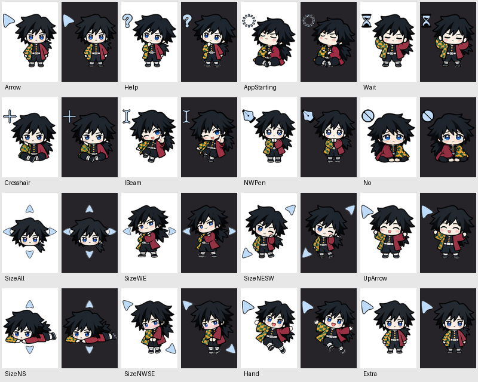 | Giyu Tomioka | [下载](https://github.com/jinhongsop-ux/tiny-cursor-packs/raw/refs/heads/main/packs/026-giyu-tomioka.zip) · [大图](previews/026-giyu-tomioka.png) |
| 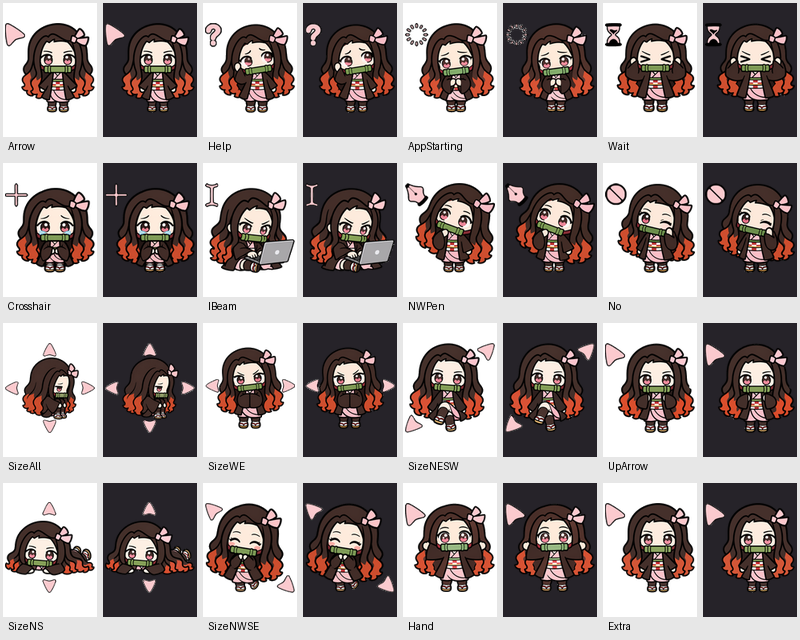 | Nezuko Kamado | [下载](https://github.com/jinhongsop-ux/tiny-cursor-packs/raw/refs/heads/main/packs/027-nezuko-kamado.zip) · [大图](previews/027-nezuko-kamado.png) |
| 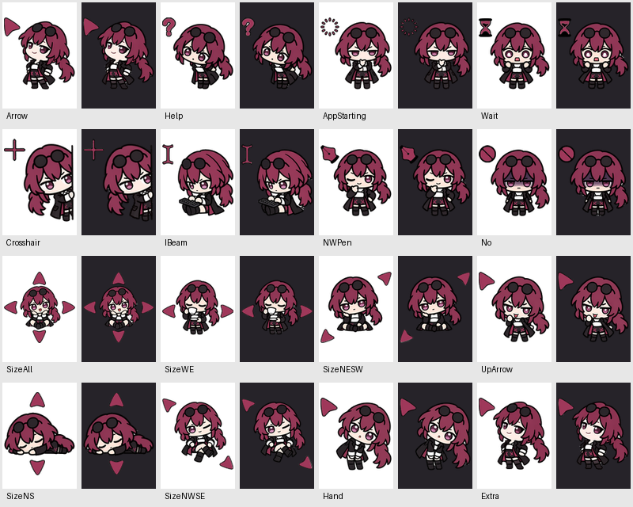 | Kafka | [下载](https://github.com/jinhongsop-ux/tiny-cursor-packs/raw/refs/heads/main/packs/028-kafka.zip) · [大图](previews/028-kafka.png) |
| 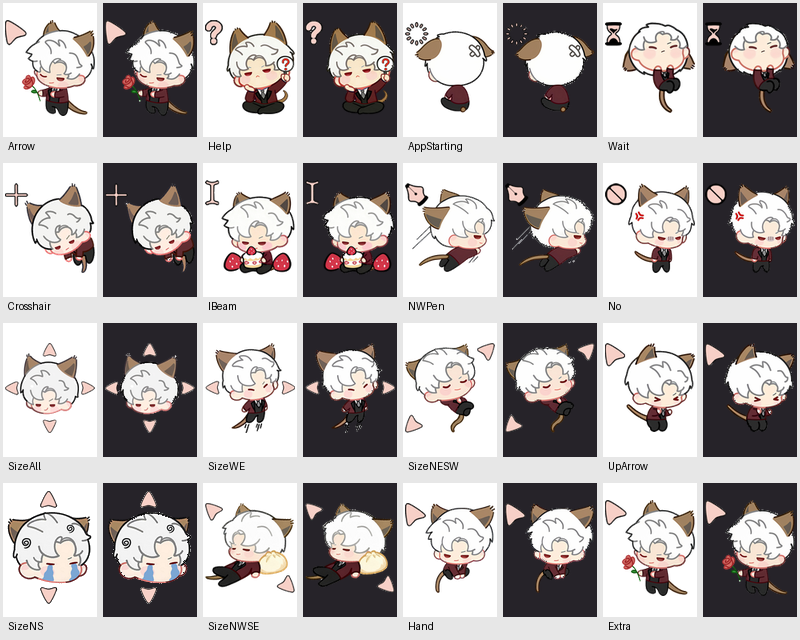 | Sylus | [下载](https://github.com/jinhongsop-ux/tiny-cursor-packs/raw/refs/heads/main/packs/029-sylus.zip) · [大图](previews/029-sylus.png) |
| 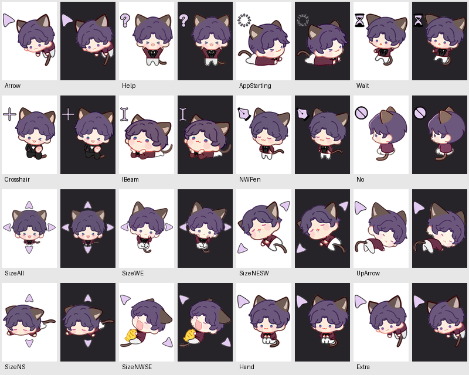 | Rafayel | [下载](https://github.com/jinhongsop-ux/tiny-cursor-packs/raw/refs/heads/main/packs/030-rafayel.zip) · [大图](previews/030-rafayel.png) |
| 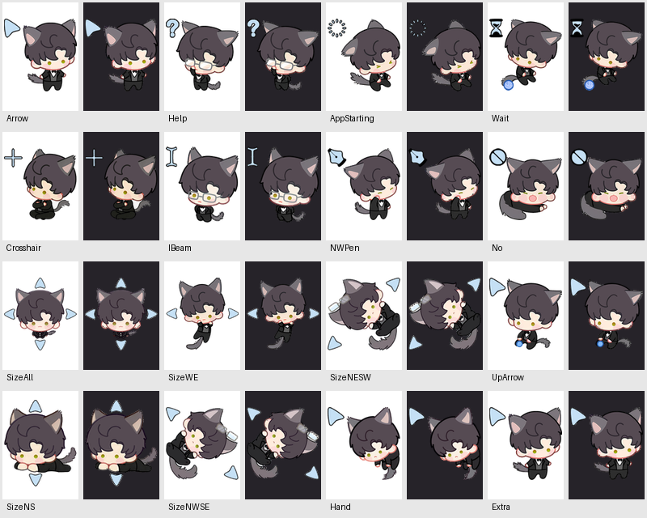 | Zayne | [下载](https://github.com/jinhongsop-ux/tiny-cursor-packs/raw/refs/heads/main/packs/031-zayne.zip) · [大图](previews/031-zayne.png) |
| 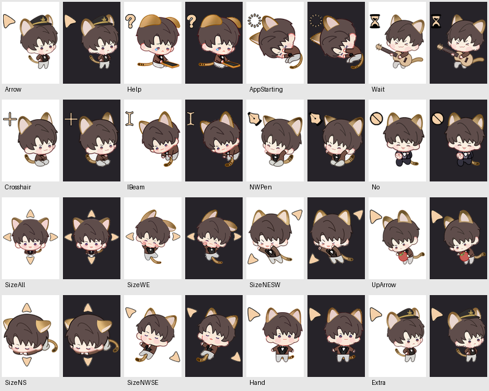 | Caleb | [下载](https://github.com/jinhongsop-ux/tiny-cursor-packs/raw/refs/heads/main/packs/032-caleb.zip) · [大图](previews/032-caleb.png) |
| 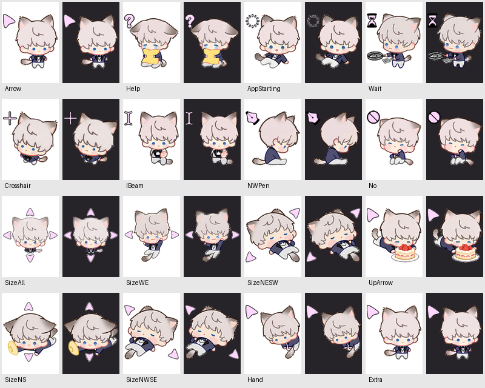 | Xavier | [下载](https://github.com/jinhongsop-ux/tiny-cursor-packs/raw/refs/heads/main/packs/033-xavier.zip) · [大图](previews/033-xavier.png) |
| 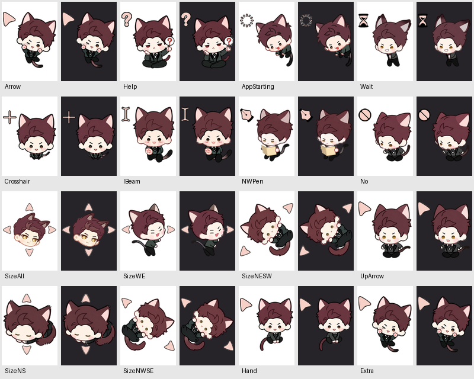 | Valko | [下载](https://github.com/jinhongsop-ux/tiny-cursor-packs/raw/refs/heads/main/packs/034-valko.zip) · [大图](previews/034-valko.png) |
| 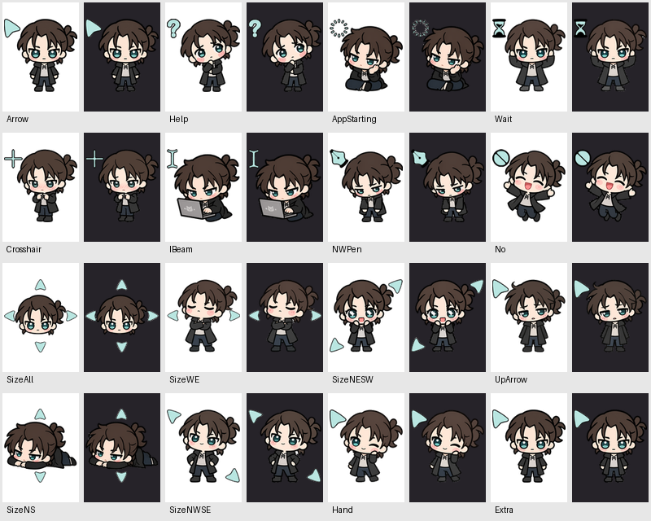 | Eren Yeager | [下载](https://github.com/jinhongsop-ux/tiny-cursor-packs/raw/refs/heads/main/packs/035-eren-yeager.zip) · [大图](previews/035-eren-yeager.png) |
| 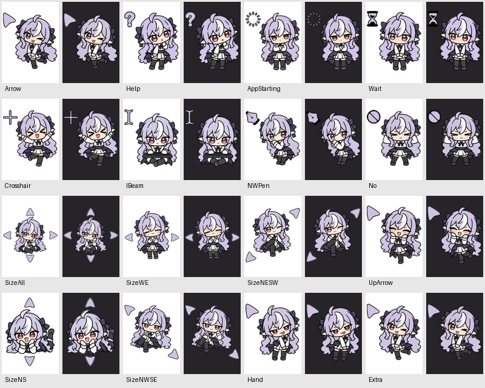 | Vivian | [下载](https://github.com/jinhongsop-ux/tiny-cursor-packs/raw/refs/heads/main/packs/036-vivian.zip) · [大图](previews/036-vivian.png) |
| 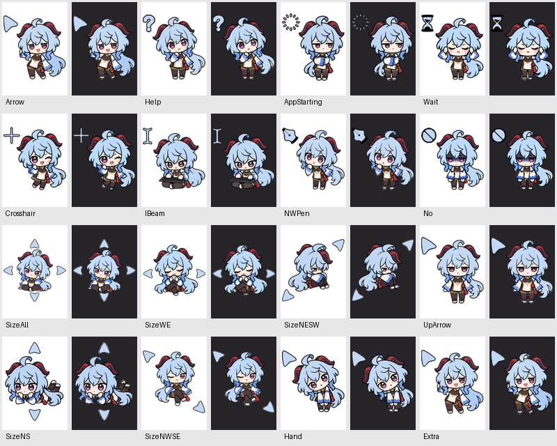 | Ganyu | [下载](https://github.com/jinhongsop-ux/tiny-cursor-packs/raw/refs/heads/main/packs/037-ganyu.zip) · [大图](previews/037-ganyu.png) |
| 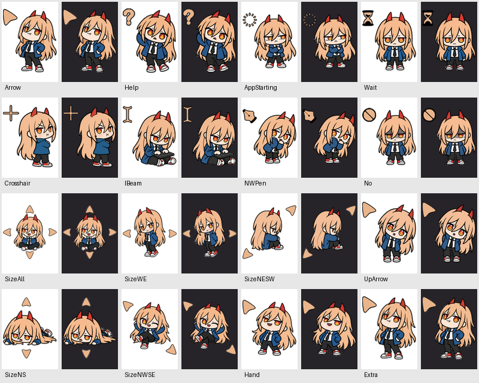 | Power | [下载](https://github.com/jinhongsop-ux/tiny-cursor-packs/raw/refs/heads/main/packs/038-power.zip) · [大图](previews/038-power.png) |
| 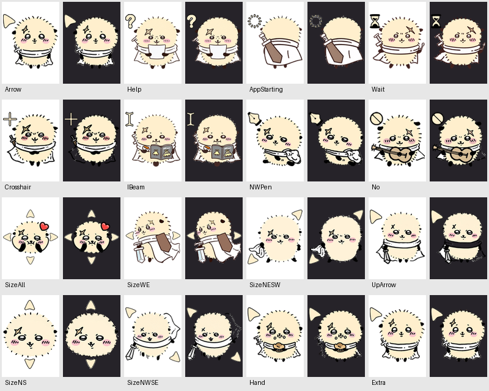 | Rakko | [下载](https://github.com/jinhongsop-ux/tiny-cursor-packs/raw/refs/heads/main/packs/039-rakko.zip) · [大图](previews/039-rakko.png) |
| 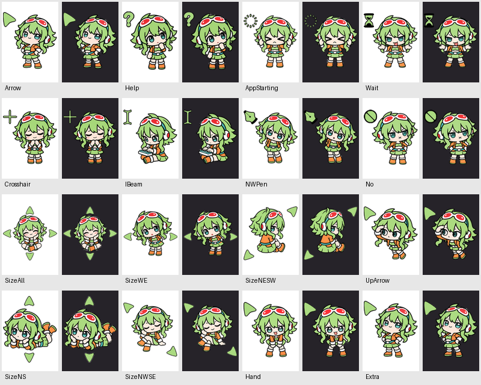 | Gumi | [下载](https://github.com/jinhongsop-ux/tiny-cursor-packs/raw/refs/heads/main/packs/040-gumi.zip) · [大图](previews/040-gumi.png) |
| 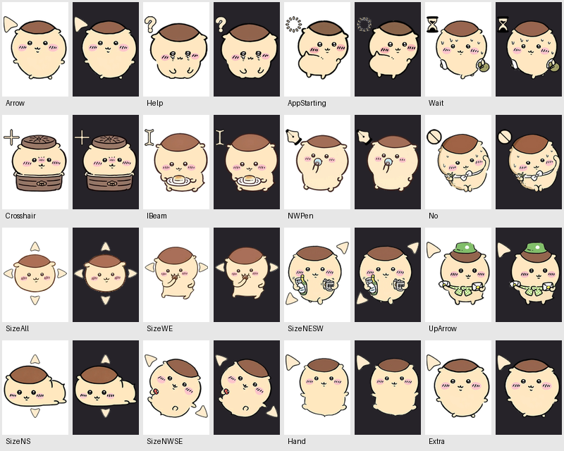 | Kurimanju | [下载](https://github.com/jinhongsop-ux/tiny-cursor-packs/raw/refs/heads/main/packs/041-kurimanju.zip) · [大图](previews/041-kurimanju.png) |
| 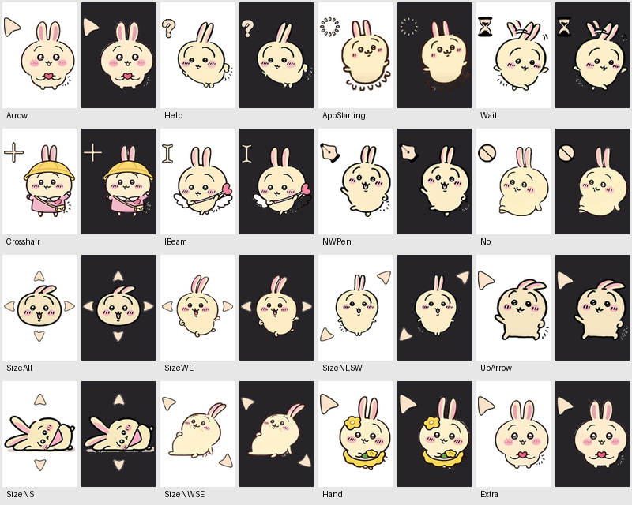 | Usagi | [下载](https://github.com/jinhongsop-ux/tiny-cursor-packs/raw/refs/heads/main/packs/042-usagi.zip) · [大图](previews/042-usagi.png) |
| 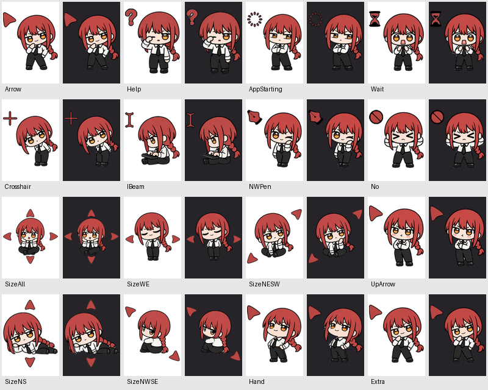 | Makima | [下载](https://github.com/jinhongsop-ux/tiny-cursor-packs/raw/refs/heads/main/packs/043-makima.zip) · [大图](previews/043-makima.png) |
| 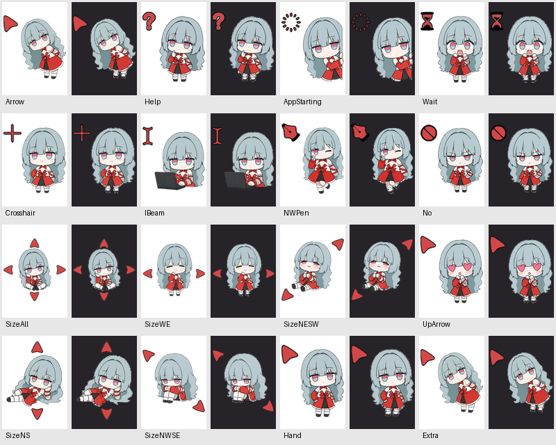 | Nono | [下载](https://github.com/jinhongsop-ux/tiny-cursor-packs/raw/refs/heads/main/packs/044-nono.zip) · [大图](previews/044-nono.png) |
| 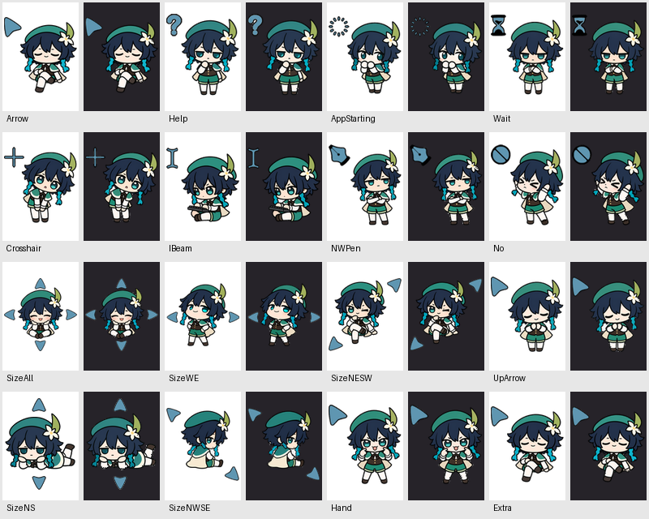 | Venti | [下载](https://github.com/jinhongsop-ux/tiny-cursor-packs/raw/refs/heads/main/packs/045-venti.zip) · [大图](previews/045-venti.png) |
| 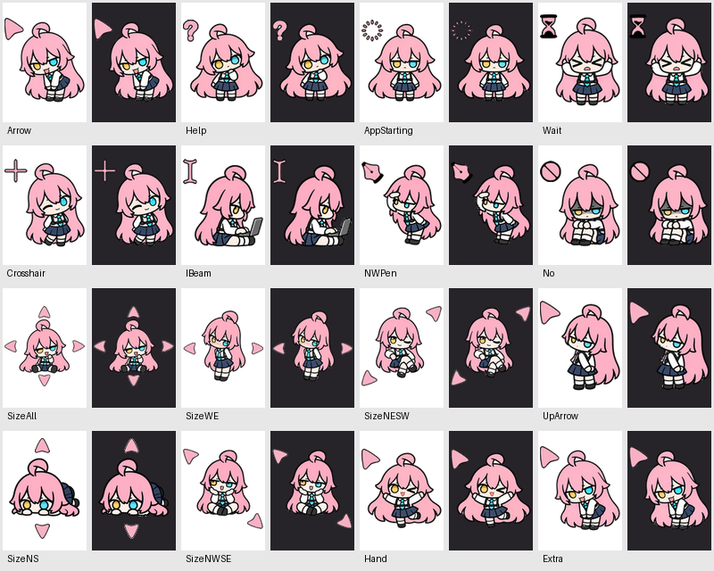 | Hoshino | [下载](https://github.com/jinhongsop-ux/tiny-cursor-packs/raw/refs/heads/main/packs/046-hoshino.zip) · [大图](previews/046-hoshino.png) |
| 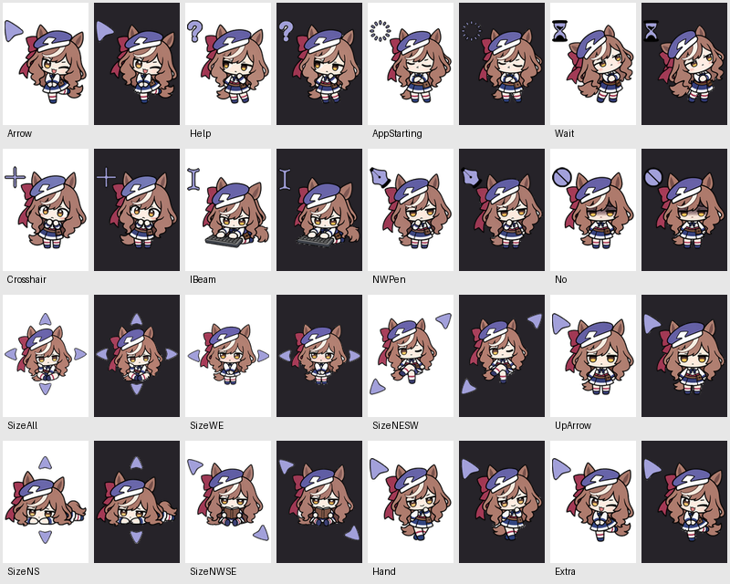 | Mambo | [下载](https://github.com/jinhongsop-ux/tiny-cursor-packs/raw/refs/heads/main/packs/047-mambo.zip) · [大图](previews/047-mambo.png) |
| 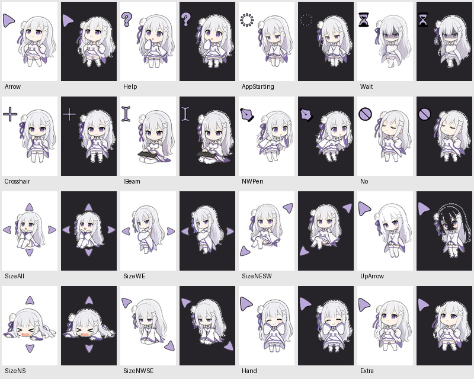 | Emilia | [下载](https://github.com/jinhongsop-ux/tiny-cursor-packs/raw/refs/heads/main/packs/049-emilia.zip) · [大图](previews/049-emilia.png) |
| 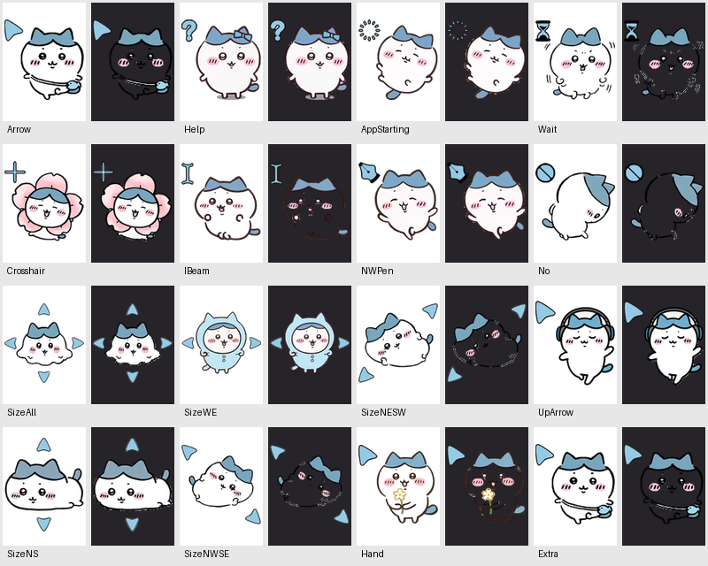 | Hachiware | [下载](https://github.com/jinhongsop-ux/tiny-cursor-packs/raw/refs/heads/main/packs/050-hachiware.zip) · [大图](previews/050-hachiware.png) |
| 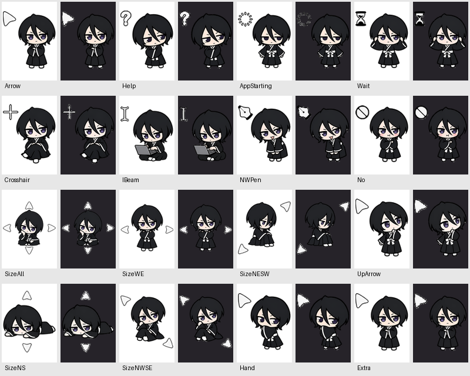 | Rukia Kuchiki | [下载](https://github.com/jinhongsop-ux/tiny-cursor-packs/raw/refs/heads/main/packs/051-rukia-kuchiki.zip) · [大图](previews/051-rukia-kuchiki.png) |
|  | Teto | [下载](https://github.com/jinhongsop-ux/tiny-cursor-packs/raw/refs/heads/main/packs/052-teto.zip) · [大图](previews/052-teto.png) |
|  | 02 ZeroTwo | [下载](https://github.com/jinhongsop-ux/tiny-cursor-packs/raw/refs/heads/main/packs/053-02-zerotwo.zip) · [大图](previews/053-02-zerotwo.png) |
|  | Yorha2b | [下载](https://github.com/jinhongsop-ux/tiny-cursor-packs/raw/refs/heads/main/packs/054-yorha2b.zip) · [大图](previews/054-yorha2b.png) |
|  | Chisa | [下载](https://github.com/jinhongsop-ux/tiny-cursor-packs/raw/refs/heads/main/packs/055-chisa.zip) · [大图](previews/055-chisa.png) |
|  | Phoebe | [下载](https://github.com/jinhongsop-ux/tiny-cursor-packs/raw/refs/heads/main/packs/056-phoebe.zip) · [大图](previews/056-phoebe.png) |
|  | Furina | [下载](https://github.com/jinhongsop-ux/tiny-cursor-packs/raw/refs/heads/main/packs/057-furina.zip) · [大图](previews/057-furina.png) |
|  | Fern one | [下载](https://github.com/jinhongsop-ux/tiny-cursor-packs/raw/refs/heads/main/packs/058-fern-one.zip) · [大图](previews/058-fern-one.png) |
|  | Gugugaga | [下载](https://github.com/jinhongsop-ux/tiny-cursor-packs/raw/refs/heads/main/packs/059-gugugaga.zip) · [大图](previews/059-gugugaga.png) |
|  | Doro | [下载](https://github.com/jinhongsop-ux/tiny-cursor-packs/raw/refs/heads/main/packs/061-doro.zip) · [大图](previews/061-doro.png) |
|  | Miyabi | [下载](https://github.com/jinhongsop-ux/tiny-cursor-packs/raw/refs/heads/main/packs/062-miyabi.zip) · [大图](previews/062-miyabi.png) |
|  | GawrGura | [下载](https://github.com/jinhongsop-ux/tiny-cursor-packs/raw/refs/heads/main/packs/063-gawrgura.zip) · [大图](previews/063-gawrgura.png) |
|  | Jane Doe | [下载](https://github.com/jinhongsop-ux/tiny-cursor-packs/raw/refs/heads/main/packs/064-jane-doe.zip) · [大图](previews/064-jane-doe.png) |
|  | Burnice | [下载](https://github.com/jinhongsop-ux/tiny-cursor-packs/raw/refs/heads/main/packs/065-burnice.zip) · [大图](previews/065-burnice.png) |
|  | HuTao | [下载](https://github.com/jinhongsop-ux/tiny-cursor-packs/raw/refs/heads/main/packs/066-hutao.zip) · [大图](previews/066-hutao.png) |
|  | Evernight | [下载](https://github.com/jinhongsop-ux/tiny-cursor-packs/raw/refs/heads/main/packs/067-evernight.zip) · [大图](previews/067-evernight.png) |
|  | Herta | [下载](https://github.com/jinhongsop-ux/tiny-cursor-packs/raw/refs/heads/main/packs/068-herta.zip) · [大图](previews/068-herta.png) |
|  | Sailor Moon | [下载](https://github.com/jinhongsop-ux/tiny-cursor-packs/raw/refs/heads/main/packs/069-sailor-moon.zip) · [大图](previews/069-sailor-moon.png) |
|  | Rengoku | [下载](https://github.com/jinhongsop-ux/tiny-cursor-packs/raw/refs/heads/main/packs/070-rengoku.zip) · [大图](previews/070-rengoku.png) |
|  | Cardcaptor Sakura | [下载](https://github.com/jinhongsop-ux/tiny-cursor-packs/raw/refs/heads/main/packs/071-cardcaptor-sakura.zip) · [大图](previews/071-cardcaptor-sakura.png) |
|  | Fluttershy | [下载](https://github.com/jinhongsop-ux/tiny-cursor-packs/raw/refs/heads/main/packs/072-fluttershy.zip) · [大图](previews/072-fluttershy.png) |
|  | Satoru Gojo | [下载](https://github.com/jinhongsop-ux/tiny-cursor-packs/raw/refs/heads/main/packs/073-satoru-gojo.zip) · [大图](previews/073-satoru-gojo.png) |
|  | Rainbow Dash | [下载](https://github.com/jinhongsop-ux/tiny-cursor-packs/raw/refs/heads/main/packs/074-rainbow-dash.zip) · [大图](previews/074-rainbow-dash.png) |
|  | Akita Neru | [下载](https://github.com/jinhongsop-ux/tiny-cursor-packs/raw/refs/heads/main/packs/075-akita-neru.zip) · [大图](previews/075-akita-neru.png) |
|  | Pinkie Pie | [下载](https://github.com/jinhongsop-ux/tiny-cursor-packs/raw/refs/heads/main/packs/076-pinkie-pie.zip) · [大图](previews/076-pinkie-pie.png) |
|  | Frieren (Series2) | [下载](https://github.com/jinhongsop-ux/tiny-cursor-packs/raw/refs/heads/main/packs/077-frieren-series2.zip) · [大图](previews/077-frieren-series2.png) |
|  | Mitsuri Kanroji | [下载](https://github.com/jinhongsop-ux/tiny-cursor-packs/raw/refs/heads/main/packs/078-mitsuri-kanroji.zip) · [大图](previews/078-mitsuri-kanroji.png) |
|  | Shinobu Kocho | [下载](https://github.com/jinhongsop-ux/tiny-cursor-packs/raw/refs/heads/main/packs/079-shinobu-kocho.zip) · [大图](previews/079-shinobu-kocho.png) |
|  | Hellokitty | [下载](https://github.com/jinhongsop-ux/tiny-cursor-packs/raw/refs/heads/main/packs/080-hellokitty.zip) · [大图](previews/080-hellokitty.png) |
|  | Tifa | [下载](https://github.com/jinhongsop-ux/tiny-cursor-packs/raw/refs/heads/main/packs/081-tifa.zip) · [大图](previews/081-tifa.png) |
|  | Raiden | [下载](https://github.com/jinhongsop-ux/tiny-cursor-packs/raw/refs/heads/main/packs/082-raiden.zip) · [大图](previews/082-raiden.png) |
|  | Marin Kitagawa | [下载](https://github.com/jinhongsop-ux/tiny-cursor-packs/raw/refs/heads/main/packs/083-marin-kitagawa.zip) · [大图](previews/083-marin-kitagawa.png) |
|  | Kirby | [下载](https://github.com/jinhongsop-ux/tiny-cursor-packs/raw/refs/heads/main/packs/084-kirby.zip) · [大图](previews/084-kirby.png) |
|  | Alya | [下载](https://github.com/jinhongsop-ux/tiny-cursor-packs/raw/refs/heads/main/packs/085-alya.zip) · [大图](previews/085-alya.png) |
|  | Tanjiro | [下载](https://github.com/jinhongsop-ux/tiny-cursor-packs/raw/refs/heads/main/packs/086-tanjiro.zip) · [大图](previews/086-tanjiro.png) |
|  | Bubbles | [下载](https://github.com/jinhongsop-ux/tiny-cursor-packs/raw/refs/heads/main/packs/087-bubbles.zip) · [大图](previews/087-bubbles.png) |
|  | Buttercup | [下载](https://github.com/jinhongsop-ux/tiny-cursor-packs/raw/refs/heads/main/packs/088-buttercup.zip) · [大图](previews/088-buttercup.png) |
|  | Panda | [下载](https://github.com/jinhongsop-ux/tiny-cursor-packs/raw/refs/heads/main/packs/089-panda.zip) · [大图](previews/089-panda.png) |
|  | Goku | [下载](https://github.com/jinhongsop-ux/tiny-cursor-packs/raw/refs/heads/main/packs/090-goku.zip) · [大图](previews/090-goku.png) |
|  | Rin | [下载](https://github.com/jinhongsop-ux/tiny-cursor-packs/raw/refs/heads/main/packs/091-rin.zip) · [大图](previews/091-rin.png) |
|  | Levi Ackerman | [下载](https://github.com/jinhongsop-ux/tiny-cursor-packs/raw/refs/heads/main/packs/092-levi-ackerman.zip) · [大图](previews/092-levi-ackerman.png) |

## 素材与使用范围

角色及原始图像版权归原权利人所有。仅用于个人非商业桌面定制；本仓库提供图片整理、Windows光标转换和安装支持。如有版权问题，可通过仓库Issue联系处理。
